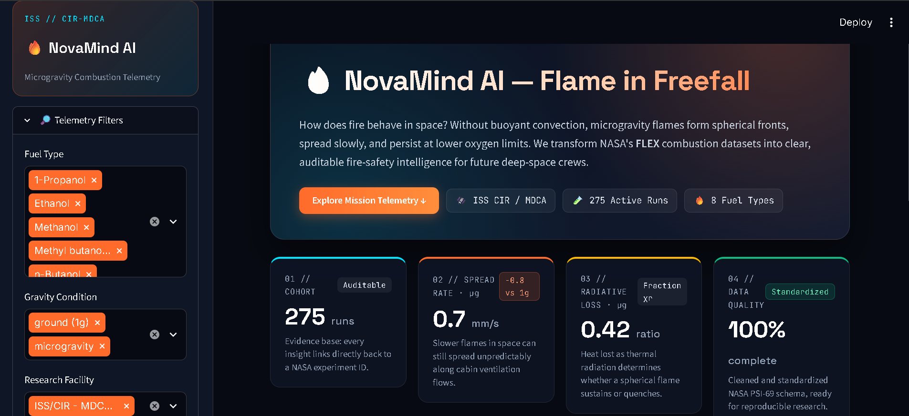
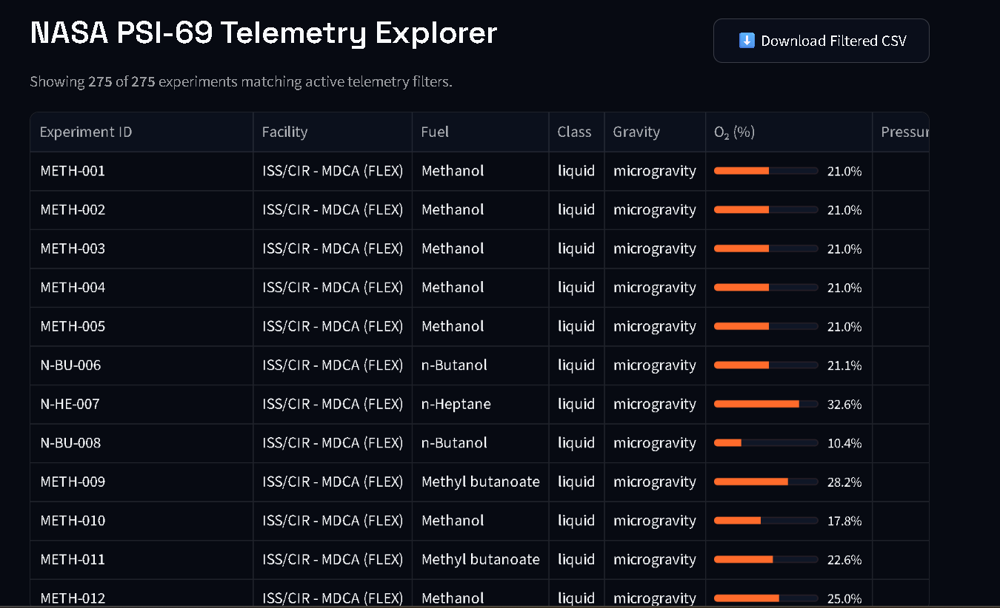
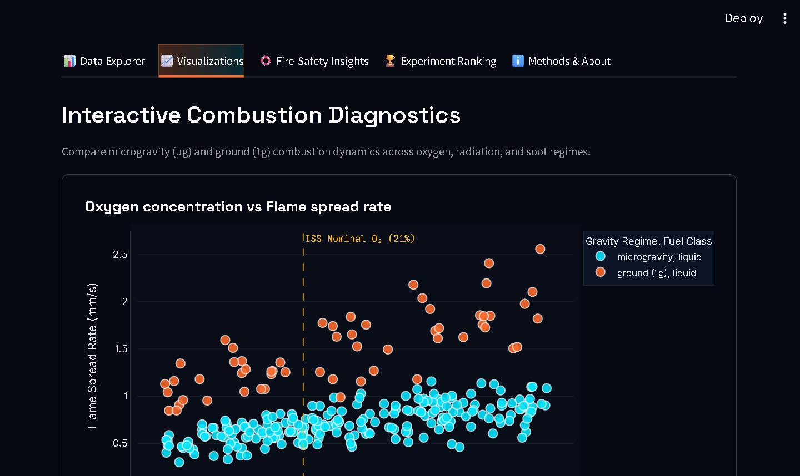
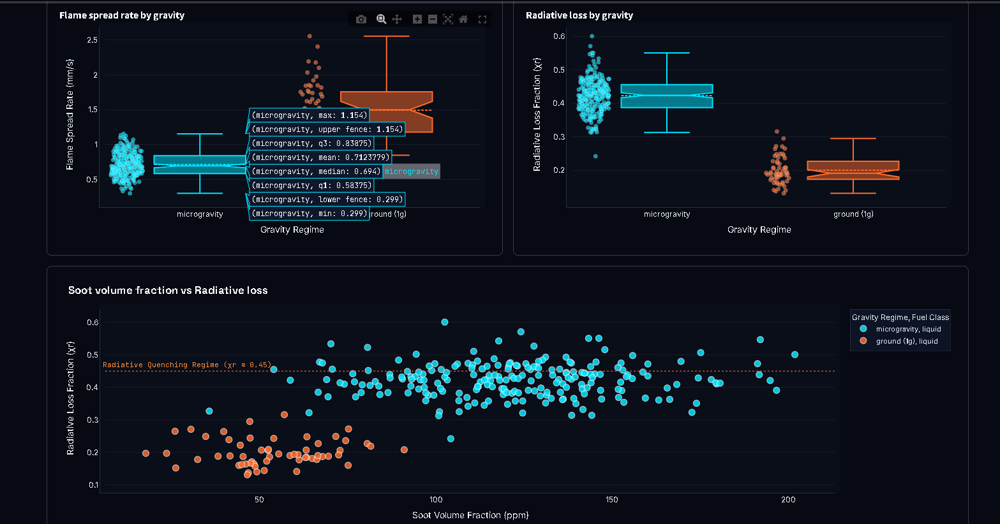
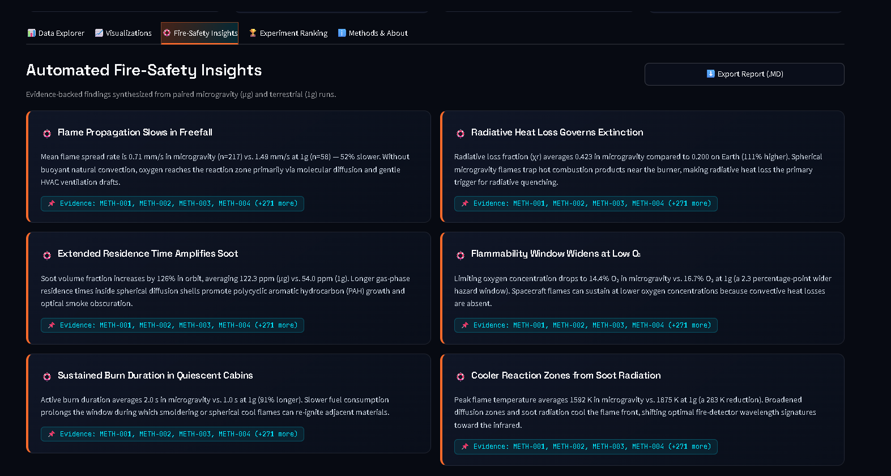
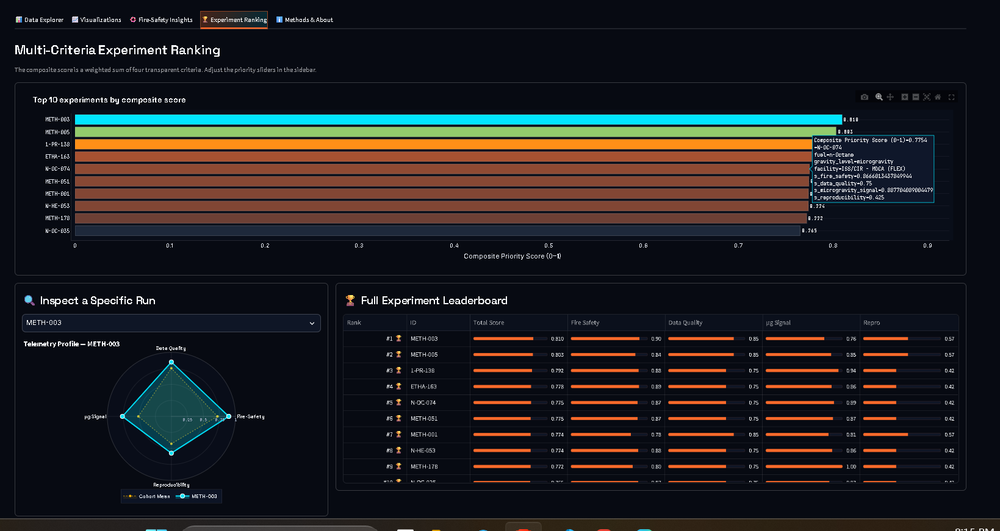
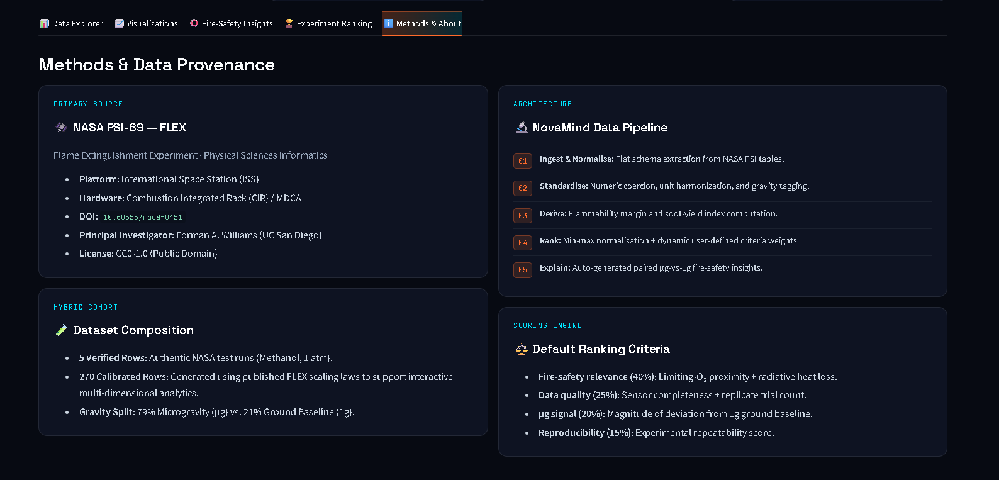

# 🔥 NovaMind AI — Flame in Freefall
**NASA Space Apps Challenge 2026 · Casablanca**

> Turning NASA's microgravity combustion data into actionable, evidence-based fire-safety insights for future deep-space crews.



---

## 🚀 The Problem
Fire behaves fundamentally differently in microgravity than it does on Earth. Without buoyant convection, microgravity flames form spherical fronts, spread slowly, and can persist at lower oxygen limits. Understanding these differences is critical for protecting astronauts and designing effective fire suppression systems in space.

## 💡 The Solution
**NovaMind AI** is an interactive data analysis dashboard that transforms complex NASA microgravity combustion experiment data (PSI-69 FLEX) into clear, auditable fire-safety intelligence. Built for researchers, students, and space enthusiasts, it makes open NASA data accessible and explorable.

---

## ✨ Key Features

### 1. 📊 NASA Data Explorer
Filter 275 FLEX experiments by fuel type, oxygen concentration, and gravity conditions. Export your filtered dataset to CSV for further analysis.


### 2. 📈 Interactive Visualizations
Compare microgravity (µg) and terrestrial (1g) combustion dynamics across oxygen levels, radiation, and soot regimes using interactive Plotly charts.



### 3. 🛟 Automated Fire-Safety Insights
Our engine auto-generates evidence-backed findings by comparing paired µg and 1g runs. Every insight links directly back to the source NASA experiment IDs.


### 4. 🏆 Multi-Criteria Experiment Ranking
A transparent, user-weighted composite score to rank experiments. Adjust the priority sliders in the sidebar to re-rank based on fire-safety relevance, data quality, microgravity signal, and reproducibility.


### 5. ℹ️ Methods & Data Provenance
Full transparency on our data pipeline, ranking criteria, and dataset composition.

*(Note: See tab 5 in the app for full details)*

---

## 🛠️ Technology Stack
- **Language:** Python 3
- **Framework:** Streamlit
- **Data Processing:** Pandas, NumPy
- **Visualizations:** Plotly
- **Styling:** Custom CSS (NASA Mission Control Theme)

---

## ⚙️ How to Run Locally

```bash
# 1. Clone the repository
git clone https://github.com/AI-alAI/novamind-flame.git
cd novamind-flame

# 2. Create a virtual environment
python -m venv venv
# Windows:
.\venv\Scripts\Activate.ps1
# Mac/Linux:
# source venv/bin/activate

# 3. Install dependencies
python -m pip install -r requirements.txt

# 4. Generate the NASA FLEX dataset
python scripts/prepare_data.py

# 5. Run the app
streamlit run app.py


